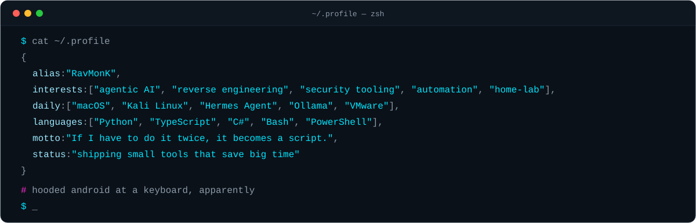
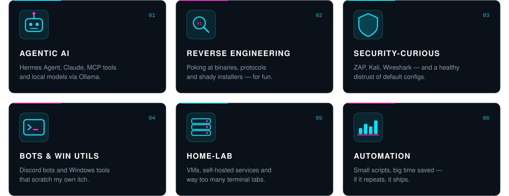
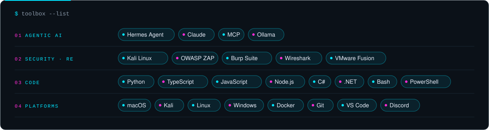
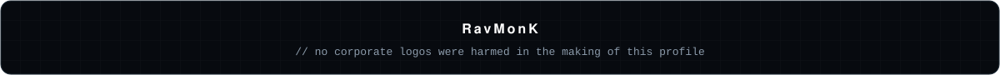

  

  

  

 

  

 

 

  

<picture>
  <source media="(prefers-color-scheme: dark)" srcset="https://raw.githubusercontent.com/RavMonK/RavMonK/output/github-snake-dark.svg"/>
  <source media="(prefers-color-scheme: light)" srcset="https://raw.githubusercontent.com/RavMonK/RavMonK/output/github-snake.svg"/>
  
</picture>

  

  

